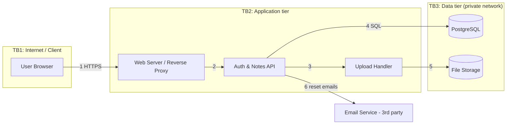

# Threat Model & Secure Hardening Plan: NoteKeep

**System:** NoteKeep, a small web app where users register, log in, write private notes and attach files.
**Method:** Data-flow diagram + STRIDE, risks ranked by Likelihood × Impact (1–5 each).
**Prepared by:** [Your Name] · Cyber Security Internship, Task 02

## 1. Scope & Assets

- **Assets:** credentials, session tokens, private notes, uploaded files, database, app secrets, availability
- **Actors:** legitimate user, internet attacker, malicious logged-in user, admin
- **Assumptions:** Node.js/Express, PostgreSQL, file storage, third-party email service, HTTPS

## 2. Data-Flow Diagram with Trust Boundaries

## 3. STRIDE Threat List

| STRIDE | Threat | Where |
|---|---|---|
| Spoofing | Credential stuffing / brute force; stolen session cookie | Flow 1, Auth API |
| Tampering | SQL injection; stored XSS; malicious file upload | Flows 1, 3, 4 |
| Repudiation | No audit logs of logins, deletes, admin actions | Auth & Notes API |
| Information disclosure | IDOR on note IDs; leaked secrets; verbose errors; unencrypted backups | Flows 2, 4, 5 |
| Denial of service | Request floods; huge uploads | Proxy, Upload Handler |
| Elevation of privilege | Broken access control; vulnerable dependencies; over-privileged DB account | API, Database |

## 4. Risk Register (ranked)

| # | Risk | STRIDE | L | I | Score | Mitigation |
|---|---|---|---|---|---|---|
| R1 | Credential stuffing / brute-force login | S | 4 | 4 | **16 High** | Rate limiting, lockout, MFA, breached-password check |
| R2 | Broken access control / IDOR on notes | I, E | 4 | 4 | **16 High** | Server-side ownership check on every request; unguessable IDs |
| R3 | SQL injection | T, I | 3 | 5 | **15 High** | Parameterized queries/ORM, validation, least-privilege DB user |
| R4 | Secrets leaked in repo or logs | I | 3 | 5 | **15 High** | Secrets manager/env vars, secret scanning, rotate keys |
| R5 | Stored XSS in notes | T | 3 | 4 | 12 Medium | Output encoding, CSP, sanitize rich text |
| R6 | Session hijacking | S | 3 | 4 | 12 Medium | HttpOnly, Secure, SameSite cookies; short expiry; rotate on login |
| R7 | Malicious file upload | T, E | 3 | 4 | 12 Medium | Allow-list types, size cap, rename, store outside web root |
| R8 | Vulnerable dependencies | E | 4 | 3 | 12 Medium | npm audit / Dependabot, pin and patch |
| R9 | No audit logging | R | 4 | 3 | 12 Medium | Central logging of auth events and data changes; alerts |
| R10 | Database exposed / unencrypted backups | I | 2 | 5 | 10 Medium | Private subnet, encryption at rest, encrypted backups |
| R11 | Request flood / resource exhaustion | D | 3 | 3 | 9 Low | Rate limits, WAF/CDN, upload and timeout limits |
| R12 | Verbose errors / info disclosure | I | 4 | 2 | 8 Low | Generic errors, disable debug, hide banners |

Scoring: 15–25 High · 10–14 Medium · below 10 Low.

## 5. Prioritized Hardening Checklist

### P1: Do first
- [ ] Enforce HTTPS everywhere with HSTS
- [ ] Rate limit and lock out repeated failed logins; offer MFA (R1)
- [ ] Check resource ownership on every note/file request (R2)
- [ ] Parameterized queries only; minimum-privilege DB user (R3)
- [ ] Move secrets out of code; enable secret scanning; rotate exposed keys (R4)
- [ ] Hash passwords with bcrypt/argon2 with per-user salt

### P2: Next
- [ ] Cookies: HttpOnly, Secure, SameSite; session expiry and rotation (R6)
- [ ] Content-Security-Policy and output encoding (R5)
- [ ] Upload allow-list, size limit, store outside web root (R7)
- [ ] Dependency scanning and patch cadence (R8)
- [ ] Central logging of auth events and deletes (R9)
- [ ] Database in private network; encrypt storage and backups (R10)

### P3: Then
- [ ] CDN/WAF and request-size limits (R11)
- [ ] Disable debug mode, hide stack traces and server banners (R12)
- [ ] Security headers: X-Content-Type-Options, X-Frame-Options, Referrer-Policy
- [ ] Re-review the threat model after every major feature

## 6. Summary

The highest risks come from weak authentication, missing authorization checks, injection and exposed secrets. Fixing the P1 items removes the most likely and most damaging attack paths; the rest adds defense in depth. Residual risk will be reviewed after implementation.
